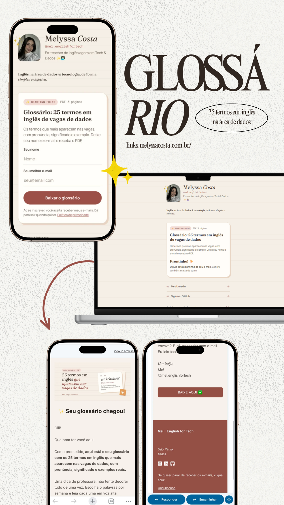
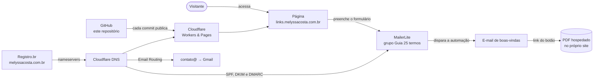

# melyssacosta-site · Página de Links com Captura de E-mails ✨✉️

**🔗 No ar:** [links.melyssacosta.com.br](https://links.melyssacosta.com.br)

Página de links do meu perfil [@mel.englishfortech](https://www.instagram.com/mel.englishfortech/), sobre **inglês e dados para mulheres que estão começando em tech**. Ela reúne meus links e oferece um **glossário gratuito em PDF**. Quem deixa nome e e-mail recebe o material automaticamente.

> **EN summary:** A hand-coded link-in-bio page with a lead magnet. Visitors sign up with name and email, get added to a MailerLite group, and an automation emails them a PDF glossary hosted on the site. Static HTML/CSS deployed on Cloudflare from GitHub, custom `.com.br` domain with Cloudflare DNS, email authentication (SPF, DKIM, DMARC) and email forwarding.

<p align="center">
  
</p>

---

## O que a página faz

- **Reúne meus links** (LinkedIn, GitHub e Instagram) numa página com a minha identidade visual.
- **Captura e-mails:** um formulário com nome e e-mail inscreve a pessoa na minha lista.
- **Entrega o material sozinha:** depois da inscrição, uma automação envia o *Glossário: 25 termos em inglês de vagas de dados* (PDF de 31 páginas).
- **Respeita a LGPD:** aviso de consentimento no formulário, política de privacidade própria e link de descadastro em todos os e-mails.
- **Funciona bem no celular**, que é de onde vem quase todo o acesso pelo Instagram.

---

## Como tudo se conecta



**Em palavras:**

1. O domínio `melyssacosta.com.br` foi registrado no **Registro.br** e passou a usar o **DNS do Cloudflare**.
2. O código fica neste repositório. A cada alteração na branch `main`, o **Cloudflare publica o site** automaticamente no subdomínio `links.`.
3. O formulário da página envia os dados para o **MailerLite**, que coloca a pessoa no grupo do guia.
4. Uma **automação** do MailerLite manda o e-mail de boas-vindas com o link do PDF, que fica em `/assets`.
5. O endereço **contato@melyssacosta.com.br** é encaminhado para o meu Gmail pelo **Cloudflare Email Routing**.

---

## Ferramentas e serviços

| Camada | Ferramenta | Para quê |
| --- | --- | --- |
| Código | HTML5, CSS3 e JavaScript puro | Página leve, rápida e fácil de editar, sem framework |
| Fontes | Google Fonts (Fraunces, Manrope, Space Mono) | Tipografia da identidade visual |
| Versionamento | Git + GitHub | Histórico do projeto e origem da publicação |
| Hospedagem | Cloudflare Workers & Pages | Publicação automática a cada commit, com HTTPS |
| Domínio | Registro.br | Registro do `melyssacosta.com.br` |
| DNS | Cloudflare DNS | Aponta o domínio para o site e para os serviços de e-mail |
| E-mail recebido | Cloudflare Email Routing | Encaminha `contato@` para o Gmail |
| E-mail marketing | MailerLite | Formulário, lista, grupo e automação de envio |
| Design | Canva + HTML/CSS | Materiais do Instagram e o PDF do glossário |
| Apoio | Claude (IA da Anthropic) | Planejamento, revisão de código, textos e design |

---

## Decisões técnicas

- **HTML e CSS puros.** É uma página só, sem login e sem banco de dados. Um framework seria peso sem ganho.
- **Formulário com o visual da página.** Em vez de usar o formulário pronto do MailerLite, mantive o meu HTML e usei só o *endpoint* e os nomes de campo dele. O script oficial do MailerLite cuida do envio e da validação. **Nenhuma chave de API fica exposta no código.**
- **Cloudflare em vez do plano gratuito da Vercel.** O plano Hobby da Vercel é só para uso não comercial. O Cloudflare permite uso comercial no plano gratuito, e o domínio já estava lá.
- **Subdomínio `links.`** Deixa o domínio principal livre para um site completo no futuro.
- **Autenticação de e-mail.** Registros SPF, DKIM e DMARC no DNS, para os e-mails não caírem no spam e para ninguém se passar pelo domínio.
- **Acessibilidade.** Campos com `<label>`, foco visível, contraste adequado e animação desligada para quem prefere menos movimento (`prefers-reduced-motion`).

---

## Identidade visual: "Café & Caderno"

Inspirada num caderno de estudos com café: aconchegante, editorial e feminina, sem clichê de tecnologia.

| Uso | Cor |
| --- | --- |
| Fundo | `#F5EFE6` |
| Cartões | `#FFFDF9` |
| Texto | `#3A2E26` |
| Destaque | `#9C4F46` |
| Etiquetas | `#F3DDD6` |
| Sombra "de papel" | `#E8D5C4` |

**Fontes:** Fraunces (títulos), Manrope (texto) e Space Mono (detalhes). Todas as cores ficam em variáveis CSS no topo do `style.css`.

---

## Estrutura

```
├── index.html          → a página (perfil, guia, formulário e links)
├── privacidade.html    → política de privacidade (LGPD)
├── style.css           → visual da página (cores e fontes em variáveis)
├── assets/
│   ├── foto.jpg
│   ├── sticker.gif
│   ├── favicon.svg
│   └── glossario-25-termos.pdf   → o material enviado por e-mail
└── docs/
    └── preview-mobile.png        → imagem deste README
```

## Rodar localmente

Não tem instalação nem build. Abra o `index.html` no navegador ou, se preferir um servidor local:

```bash
python -m http.server 8000
# acesse http://localhost:8000
```

## Publicação

Qualquer commit na branch `main` gera uma nova publicação no Cloudflare em cerca de um minuto.

---

## Próximos passos

- [ ] Página de serviços de BI para pequenos negócios
- [ ] Sequência de boas-vindas por e-mail (dias 3 e 7) e newsletter quinzenal
- [ ] Dashboards de exemplo com dados fictícios para o portfólio
- [ ] Painel com as métricas da página e da lista de e-mails

---

Feito por **Melyssa Costa**, analista de dados.
[LinkedIn](https://www.linkedin.com/in/melyssa-costa) · [GitHub](https://github.com/melyss-q) · contato@melyssacosta.com.br
